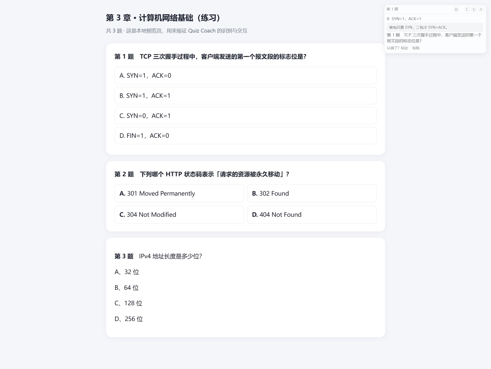
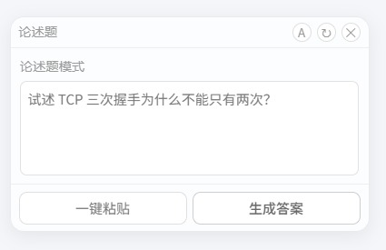

# Quiz Coach

[中文](README.md) | **English**

> A tiny semi-transparent card for web pages: open it and get the answer to a multiple-choice question. Works as a Chrome / Edge extension and on iPad Safari.

[](LICENSE)

> **Purpose**: a study aid for self-testing, practice and checking answers. **Do not use it for exam cheating.** This project is not affiliated with any exam platform.

## Screenshots

**C · Multiple-choice mode** — reads the question and options on the page.



**A · Essay mode** — paste a prompt, get an English answer under 150 words, copy it in one tap.



## Features

- **C · Multiple-choice mode**: reads the current page's question and options, then shows the answer (original option label + option text + a short explanation) after you open the dot at the top-right. Use **↻** to cycle through multiple questions on one page.
- **A · Essay mode**: no page reading, paste only. Copy the prompt → click **一键粘贴** (paste) → get an English essay answer; the number of points depends on the question, the answer is hard-capped at 150 words, and over-long drafts are rewritten/compressed with a complete final sentence → click **复制** (copy).
- **Fallbacks**: two-step clipboard (question, then options) or one-time per-site calibration when automatic detection fails.
- **Low footprint**: frosted semi-transparent card; collapses to a small grey dot; draggable and remembers its position.
- **No relay**: requests go from the page directly to the API endpoint you configure.

## Install

### Route A: iPad without a Mac (recommended)

Safari content scripts and userscripts are the same thing. With the free **Userscripts** app you can run the script in Safari without an Apple developer signature.

1. Open `userscript/quiz-coach.user.js` in a text editor and fill in `apiKey` at the top (you can also leave it empty and set it later in the card).
2. Transfer the file to the iPad (Files app, iCloud, email, etc.).
3. Install **Userscripts** from the App Store (by quoid, free and open source) and choose a folder as the script directory.
4. Move `quiz-coach.user.js` into that folder and make sure the script is enabled in Userscripts.
5. iPad → Settings → Safari → Extensions → **Userscripts** → enable → **Allow all websites**.
6. In Safari, tap **aA** in the address bar → **Manage Extensions** → enable Userscripts.
7. A small semi-transparent dot appears at the top-right of every page. Tap it to open the card.

> The script matches all sites (`@match *://*/*`). Tap × to hide it.

### Route B: Chrome / Edge (fastest)

1. Open `chrome://extensions` (Edge: `edge://extensions`) and enable Developer mode.
2. Click "Load unpacked" and select `Extension/Resources`.
3. Click the Quiz Coach toolbar icon, fill in API endpoint / key / model, and save.
4. The dot appears on any page.

> The extension asks for "read and change all your data on all websites" because the content script has to inject the card everywhere. It only reads page text and does not upload page content.

### Route C: Native Safari extension on iPad (requires a Mac)

For a native extension installation with a toolbar-based settings panel, use Xcode signing.

1. Xcode → File → New → Project… → search `Safari` → **Safari Extension App** → Product Name `QuizCoach`.
2. Copy the files in `Extension/Resources/` into `QuizCoach Extension/Resources/`.
3. Signing & Capabilities → choose your Apple ID as Team → make the Bundle ID unique.
4. Connect the iPad, select it as the run target, press **⌘R**; enable Developer Mode if prompted.
5. iPad → Settings → Safari → Extensions → QuizCoach → enable → Allow all websites.
6. Safari → aA → Manage Extensions → enable QuizCoach.

> Free Apple IDs expire after 7 days; reconnect to the Mac and press ⌘R to renew.

## Usage

- Tap the grey dot at the top-right to get the answer (usually 1–3 seconds).
- The card header has three small round buttons: **A / C** (toggle mode), **↻** (refresh / next question), **✕** (collapse).
- **Long-press the title for 0.7 s** (right-click on desktop) to open settings: endpoint / key / model, or calibrate the current site.
- When detection fails, the footer shows **重新提取** (re-extract), **读剪贴板** (read clipboard), **标定** (calibrate).
  - Clipboard is two steps: paste the question, then the options. `A/B/C/D` and `1/2/3/4` are both accepted; one option per line works best.
- At the bottom of an answer there are two tiny text buttons: **认错了？标定** (wrong question? calibrate) and **粘贴** (paste).
- In A mode, after generation the card only shows "答案已生成 · 约 N 词 / 点「复制」直接拿走"; the card size does not change.

## Models

The defaults in the code are:

| Setting | Default |
|---|---|
| API endpoint | `https://api.deepseek.com/v1/chat/completions` |
| Model | `deepseek-chat` |
| API key | empty — fill in your own |

Where to change:

- **Extension**: toolbar icon → fill endpoint / key / model → Save.
- **Userscript**: long-press the card title for 0.7 s (right-click on desktop) → Settings; or edit `__QUIZ_COACH_CONFIG__` at the top of `quiz-coach.user.js`.

Switching models is supported as long as the provider offers an **OpenAI-compatible** `POST /v1/chat/completions` (`Authorization: Bearer <key>`; same request and response shape). Examples (model names are examples only — check the provider's dashboard):

| Provider | Endpoint example | Model example |
|---|---|---|
| DeepSeek | `https://api.deepseek.com/v1/chat/completions` | `deepseek-chat` |
| SiliconFlow | `https://api.siliconflow.cn/v1/chat/completions` | `Qwen/Qwen2.5-7B-Instruct`, etc. |
| Alibaba DashScope | `https://dashscope.aliyuncs.com/compatible-mode/v1/chat/completions` | `qwen-plus` |
| Zhipu | `https://open.bigmodel.cn/api/paas/v4/chat/completions` | `glm-4-flash` |
| OpenRouter | `https://openrouter.ai/api/v1/chat/completions` | `openai/gpt-4o-mini`, etc. |
| OpenAI | `https://api.openai.com/v1/chat/completions` | `gpt-4o-mini`, etc. |
| Ollama (local) | `http://127.0.0.1:11434/v1/chat/completions` | `qwen2.5:7b`, etc. |

Notes:

- **C mode** requires strict JSON output (`answer` / `confidence` / `explain`). Models with weak instruction following may fail.
- **A mode** requires English writing and a 150-word limit; if the model overshoots, the client makes one compression request.
- **No image/vision support** yet; a text-only model is enough.
- Direct browser requests depend on the provider's **CORS** policy. If you see `Load failed` / `Failed to fetch`, use a CORS-enabled endpoint or your own proxy. Ollama needs `OLLAMA_ORIGINS=*`.
- Native non-OpenAI APIs (Azure OpenAI, Gemini native, Claude native, etc.) are not compatible; use a compatibility layer or gateway.
- The card UI and C-mode explanations are currently Chinese; A-mode output is always English.

## How questions are detected

Three layers:

1. **Calibrated sites** (most accurate): click **标定** and pick the question stem, then the container that holds all options.
2. **Automatic detection**: look for option groups like `A. … / B. …`, take the topmost one in the viewport; also handles `1、`, `①`, tables, split-label elements and bare radio inputs.
3. **Clipboard**: select and copy the question stem, click **读剪贴板**, paste the question, then paste the options.

The card always shows the **original labels from the page**, not the internal A/B/C/D.

## Privacy

- Question text is sent only to the API endpoint you configure. There is no relay server and no analytics.
- The API key is stored locally (extension storage / site localStorage) and is never uploaded anywhere else.
- There is no screenshot, screen-recording, hidden-window or detection-bypass code; the script only reads page text.
- **The repository contains no real API keys.** Do not commit a file with your key; enable usage alerts at your provider.
- Model providers process request content under their own privacy policy. For example, the [DeepSeek Open Platform Privacy Policy](https://cdn.deepseek.com/policies/zh-CN/deepseek-open-platform-privacy-policy.html) states that, unless otherwise agreed in writing, API inputs and outputs may be used to improve models after encryption and de-identification. Do not paste sensitive content.

## Disclaimer

This project is for self-testing, practice, checking answers and study assistance only. Follow the terms of your school, exam platform and the websites you use. Do not use it for exam cheating, impersonation or any violation of academic integrity. You are responsible for how you use it. This project is not affiliated with DeepSeek or any exam platform.

## Limitations

- It only reads DOM text. Questions drawn entirely on a canvas are not readable (use the clipboard).
- The card is an in-page element and **will appear in screen recordings**.
- In userscript mode, settings are stored per site by default; in extension mode they are global.
- A mode always outputs English and is capped at 150 words; in the rare case two compression attempts still exceed the limit, it trims at whole-sentence boundaries.
- Screenshot / vision recognition is not implemented.

## Local preview / development

```powershell
cd quiz-coach
python -m http.server 8788
```

- Extension logic: <http://127.0.0.1:8788/tools/preview.html>
- Userscript version: <http://127.0.0.1:8788/tools/userscript-test.html>

To test the request/response path without spending credits:

```powershell
python tools/mock_api.py
```

Set the API endpoint to `http://127.0.0.1:8789/v1/chat/completions` and any key.

`Extension/Resources/content.js` is the only source of logic; `userscript/quiz-coach.user.js` is header + `content.js`. Rebuild with `tools/build-userscript.cmd`, or on macOS / Linux:

```bash
cat tools/userscript-header.txt Extension/Resources/content.js > userscript/quiz-coach.user.js
```

> `tools/userscript-header.txt` is intentionally empty. Put your key in the generated `.user.js` or in the card settings; do not commit a header with a key.

## Directory layout

```
quiz-coach/
├── Extension/Resources/      # Chrome/Edge + Safari extension resources
│   ├── content.js            # ★ the only source of logic
│   ├── manifest.json
│   ├── popup.html / popup.js
│   └── icons/
├── userscript/
│   └── quiz-coach.user.js    # generated; this is the iPad file
├── tools/
│   ├── preview.html          # local preview
│   ├── userscript-test.html  # userscript test page
│   ├── formats-test.html     # option-format test page
│   ├── mock_api.py           # local mock model
│   ├── build-userscript.cmd  # rebuild .user.js
│   └── serve.cmd
├── docs/                     # screenshots
├── LICENSE
├── README.en.md
└── README.md
```

## License

[MIT](LICENSE)
