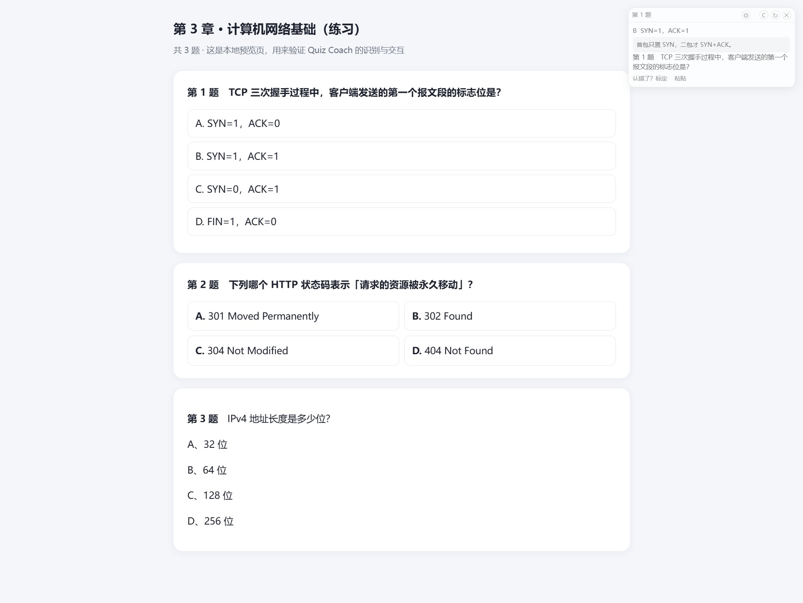
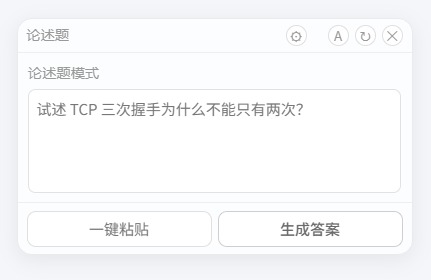
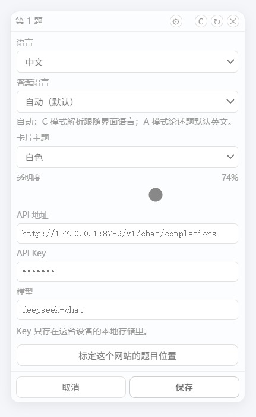

# Quiz Coach

**中文** | [English](README.en.md)

**一个 iPad / iPhone 优先的 Safari 答题辅助 —— an iPad-first alternative.**

> 网页上的选择题，点开就出答案。一张半透明小卡片：iPhone / iPad / Mac 的 Safari，以及 Chrome / Edge 都能用。

A tiny floating card that answers multiple-choice questions on web pages. Built iPad-first; essay mode turns a pasted prompt into a concise English answer you can copy in one tap.

[](LICENSE)

**平台**：iOS / iPadOS Safari（Userscripts，无需 Mac）· macOS Safari · Chrome / Edge

> **定位**：自测、练习、核对答案的学习辅助工具。**请勿用于考试作弊**。本项目与任何考试平台无关。

## 下载

**方式一：发布包（推荐）**

打开 [Releases](https://github.com/4reaLuc4s/quiz-coach-safari/releases/latest)，下载：

- `quiz-coach-safari-1.3.0.zip`：完整包，包含扩展、用户脚本、工具和截图
- `quiz-coach.user.js`：只要 iPhone / iPad 用户脚本的，直接下这个

**方式二：Code → Download ZIP**

仓库页右上角绿色 **Code** 按钮 → **Download ZIP**，解压后使用。

**方式三：git clone**

```bash
git clone https://github.com/4reaLuc4s/quiz-coach-safari.git
```

> 只用 iPhone / iPad 的话，不需要整个仓库，下载 `quiz-coach.user.js` 就够了。
> 仓库和发布包都**不含 API Key**；第一次使用在卡片设置里填。

## 为什么是 iPad / iPhone 优先

- **Safari 直接装**：用免费的 **Userscripts** 扩展，不需要 Mac、不需要 Apple 开发者账号，也没有 7 天签名过期。
- **iPhone / iPad / Mac 通用**：同一份 `userscript/quiz-coach.user.js`，在这三种 Safari 里都能跑。
- **原生扩展路线**：仓库同时包含 Safari Web Extension 资源，有 Mac 可以签名成原生扩展。
- **无后端**：请求从页面直接发到你配置的 API 端点，没有中转。

## 截图

**C · 选择题模式** —— 读页面上的题干和选项，点开就出答案。



**A · 论述题模式** —— 粘贴题目，生成 150 词（中文 150 字）以内的答案，一键复制。



> 英文版截图见 [README.en.md](README.en.md)；卡片界面默认跟随浏览器语言，设置里可切换。

---

## 功能

- **C · 选择题模式**：读取当前网页的题干和选项，点开右上角的小灰点直接出答案——原页面编号 + 选项原文 + 25 字以内解析。一页多题时点 **↻** 换下一道。
- **A · 论述题模式**：不读网页，只走粘贴。复制题目 → 点「一键粘贴」→ 自动生成论述答案（默认英文，可在设置里改成中文；英文 150 words / 中文 150 字上限，超了会换说法/合并观点重写压缩，结尾保持完整句子）→ 点「复制」拿走。
- **识别兜底**：抓不到题时可用两步剪贴板（先粘题目、再粘选项），或对网站做一次手动标定。
- **低打扰**：半透明白底 + 磨砂，收起后只剩一个小灰点；位置可拖动并记住。
- **无中转**：请求从页面直接发到你配置的 API 端点，没有服务器。

## 安装

### 路线 A：iPhone / iPad，不需要 Mac（推荐）

原理：Safari 的「内容脚本」和「用户脚本」是同一件事。用 App Store 里免费的 **Userscripts** 扩展，就能在没有开发者签名的情况下把脚本跑在 iOS / iPadOS 的 Safari 里。零签名、零 7 天过期。

1. 从上方「下载」拿到 `quiz-coach.user.js`（Release 单文件，或解压 zip 后取 `userscript/quiz-coach.user.js`），用记事本打开，最上面的 `apiKey` 可以现在填；留空也行，之后在卡片设置里按网站填。
2. 把文件传到 iPhone / iPad（微信文件传输助手 / iCloud / 邮件都可以），存到「文件」。
3. App Store 搜 **Userscripts**（作者 quoid，免费开源），打开后选一个文件夹作为「脚本目录」。
4. 回到「文件」，把 `quiz-coach.user.js` 移进那个目录；再打开 Userscripts，确认开关是开的。
5. iPhone / iPad → 设置 → Safari → 扩展 → **Userscripts** → 打开 → **允许所有网站**。
6. Safari 里打开任意网页 → 地址栏左侧 **aA** → **管理扩展** → 勾上 Userscripts。
7. 页面右上角出现**半透明小灰点**，点开就是卡片。

> 脚本对所有网站生效（`@match *://*/*`）。不想看时点卡片上的 ×。

### 路线 B：Chrome / Edge（最快）

1. 打开 `chrome://extensions`（Edge 是 `edge://extensions`），右上角开「开发者模式」。
2. 「加载已解压的扩展程序」→ 选解压后 `Extension/Resources` 目录。
3. 工具栏点 Quiz Coach 图标 → 填 API 地址 / Key / 模型 → 保存。
4. 任何网页右上角出现小灰点即可用。

> 扩展会申请「读取和更改所有网站上的数据」，因为内容脚本需要在任意页面注入卡片；它只读页面文字，不上传页面内容。

### 路线 C：iPhone / iPad 原生 Safari 扩展（需要 Mac）

想要「设置面板在 Safari 工具栏里、用原生扩展安装」的体验，就走 Xcode 签名。没有 Mac 可以跳过。

1. Xcode → File → New → Project… → 搜 `Safari` → **Safari Extension App** → Product Name `QuizCoach`。
2. 把 `Extension/Resources/` 里的文件覆盖进 `QuizCoach Extension/Resources/`。
3. Signing & Capabilities → Team 选自己的 Apple ID → Bundle ID 改成唯一的。
4. iPhone / iPad 连线 → 选为运行目标 → **⌘R**；提示开发者模式就去 设置 → 隐私与安全性 → 开发者模式。
5. iPhone / iPad 设置 → Safari → 扩展 → QuizCoach → 打开 → 允许所有网站。
6. Safari → aA → 管理扩展 → 勾上 QuizCoach。

> 免费 Apple ID 的签名 7 天过期，到期要连回 Mac 按一次 ⌘R。

## 使用

- 点右上角的**小灰点** → 直接开始取答案，1–3 秒后出结果。
- 卡片顶部有四个小圆钮：**⚙ 设置**、**A / C**（切模式）、**↻**（刷新 / 换一题）、**✕**（收起）。⚙ 和 A/C 之间留了空隙，避免点错。
- **语言**：默认跟随浏览器（中文 / English）；可在设置里切换「自动 / 中文 / English」。
- **点 ⚙ 或长按标题 0.7 秒**（电脑上右键）打开设置：卡片语言、答案语言、主题、透明度、API 地址 / Key / 模型，或给这个网站做「标定」。
- 抓不到题时，底部是：**重新提取**、**读剪贴板**、**标定**。
  - 剪贴板是两步：① 先粘题目 → 下一步 ② 再粘选项 → 出答案。选项 `A/B/C/D` 和 `1/2/3/4` 都认，每行一个最稳。
- 答案最下面有两个小文字按钮：**认错了？标定** 和 **粘贴**。
- A 模式生成后只显示「答案已生成 · 约 N 词 / 约 N 字 / 点「复制」直接拿走」，浮窗尺寸不变。

## 设置

点卡片顶部的 **⚙**（或长按标题 0.7 秒）打开设置：

- **卡片语言**：自动 / 中文 / English
- **答案语言**：自动 / 中文 / English。自动时 C 模式解析跟随界面语言，A 模式论述题默认英文
- **卡片主题**：白色 / 黑色
- **透明度**：30%–100%（只影响卡片底色）
- **API 地址 / Key / 模型**，以及按网站标定



## 模型配置

默认配置在代码里写死为：

| 项 | 默认值 |
|---|---|
| API 地址 | `https://api.deepseek.com/v1/chat/completions` |
| 模型 | `deepseek-chat` |
| API Key | 空，需要自己填 |

设置入口：

- **扩展**：工具栏 Quiz Coach 图标 → 填 API 地址 / Key / 模型 → 保存
- **用户脚本**：点卡片顶部 ⚙ 或长按标题 0.7 秒（桌面右键）→ 设置；或直接改 `quiz-coach.user.js` 顶部的 `__QUIZ_COACH_CONFIG__`

换模型是可行的，前提是对方提供 **OpenAI 兼容** 的 `POST /v1/chat/completions`（`Authorization: Bearer <key>`，请求体和返回体同 OpenAI）。示例（模型名只是示例，以厂商控制台为准）：

| 厂商 | API 地址示例 | 模型示例 |
|---|---|---|
| DeepSeek | `https://api.deepseek.com/v1/chat/completions` | `deepseek-chat` |
| 硅基流动 | `https://api.siliconflow.cn/v1/chat/completions` | `Qwen/Qwen2.5-7B-Instruct` 等 |
| 阿里百炼 | `https://dashscope.aliyuncs.com/compatible-mode/v1/chat/completions` | `qwen-plus` |
| 智谱 | `https://open.bigmodel.cn/api/paas/v4/chat/completions` | `glm-4-flash` |
| OpenRouter | `https://openrouter.ai/api/v1/chat/completions` | `openai/gpt-4o-mini` 等 |
| OpenAI | `https://api.openai.com/v1/chat/completions` | `gpt-4o-mini` 等 |
| Ollama（本地） | `http://127.0.0.1:11434/v1/chat/completions` | `qwen2.5:7b` 等 |

注意：

- **C 模式**要求模型能严格按提示输出 JSON（`answer` / `confidence` / `explain`）；指令跟随差的模型可能解析失败。
- **A 模式**要求模型能写英文，并尽量遵守 150 words 上限；超了客户端会再请求一次压缩。
- 目前**不支持图片/视觉模型**，纯文本模型就够。
- 能否浏览器直连取决于厂商的 **CORS**。报 `Load failed` / `Failed to fetch` 时，换允许直连的端点或自建代理；Ollama 需要设置 `OLLAMA_ORIGINS=*`。
- Azure OpenAI、Gemini 原生、Claude 原生等**不是 OpenAI 兼容格式**，不能直接填，需要兼容层/网关。
- 卡片界面默认跟随浏览器语言（中文 / English），可在设置里切换；C 模式解析和 A 模式论述文都受「答案语言」控制（自动 = 解析跟随界面、论述默认英文）。

## 识别策略

选项识别分三层：

1. **标定过的网站**（最准）：抓不到题时点「标定」，先点题干、再点包住所有选项的外框。
2. **自动识别**：找页面上像 `A. xxx / B. xxx` 的选项组，取视口里最靠上的那道；也覆盖 `1、`、`①`、表格、独立标号元素、空白单选圆钮等写法。
3. **剪贴板**：长按选中题干 → 复制 → 点「读剪贴板」→ 粘题目 → 下一步 → 粘选项 → 出答案。

卡片上显示的一律是**原页面的编号**，不是内部的 A/B/C/D。

## 隐私

- 题目文本只发到你填的那一个 API 端点，代码里没有中转服务器、没有统计上报。
- Key 只存在本机（扩展 storage / 站点 localStorage），不上传。
- 代码里没有截屏、录屏、隐藏窗口、绕过检测的逻辑；它只读当前页面的文字。
- **仓库不包含任何真实 API Key**；请不要把你填好 Key 的文件提交到 GitHub，也建议开启厂商的用量告警。
- 模型厂商会按其隐私政策处理请求内容。例如 [DeepSeek 开放平台隐私政策](https://cdn.deepseek.com/policies/zh-CN/deepseek-open-platform-privacy-policy.html) 写明：除另有书面约定外，API 输入输出可能在加密、去标识化后用于模型改进。敏感内容请勿粘贴。

## 免责声明

本项目仅用于自测、练习、核对答案和学习辅助。请遵守你所在学校、考试平台和网站的服务条款；请勿用于考试作弊、代考或任何违反学术诚信的用途。因使用本项目产生的后果由使用者自行承担。本项目与 DeepSeek 及任何考试平台均无关联。

## 已知限制

- 只读 DOM 里的文字；整页 canvas 画出来的题读不到（可以走剪贴板）。
- 卡片是页面内元素，**会出现在录屏里**。
- 用户脚本模式下设置默认按网站各存一份；扩展模式是全局的。
- A 模式默认英文（答案语言可切中文），英文严格 150 words / 中文 150 字上限；极端情况下两次改写仍超限时会按完整句子取舍。
- 截图 / 视觉识别暂未实现。

## 本地预览 / 开发

```powershell
cd quiz-coach-safari
python -m http.server 8788
```

- 扩展版逻辑：<http://127.0.0.1:8788/tools/preview.html>
- 用户脚本版：<http://127.0.0.1:8788/tools/userscript-test.html>

想不花额度跑通请求链路：

```powershell
python tools/mock_api.py
```

把 API 地址填 `http://127.0.0.1:8789/v1/chat/completions`，Key 随便填。

`Extension/Resources/content.js` 是唯一的逻辑源；`userscript/quiz-coach.user.js` = 文件头 + `content.js`，改完运行 `tools/build-userscript.cmd` 重新生成。macOS / Linux 可以用：

```bash
cat tools/userscript-header.txt Extension/Resources/content.js > userscript/quiz-coach.user.js
```

> 仓库里的 `tools/userscript-header.txt` 故意留空。要填 Key 请直接改生成后的 `.user.js`，或在卡片设置里填；不要把含 Key 的 header 提交上来。

## 目录结构

```
quiz-coach-safari/
├── Extension/Resources/      # Chrome/Edge 扩展 + Safari 扩展资源
│   ├── content.js            # ★ 唯一逻辑源
│   ├── manifest.json
│   ├── popup.html / popup.js
│   └── icons/
├── userscript/
│   └── quiz-coach.user.js    # 生成物，装到 iPhone / iPad 的就是这个
├── tools/
│   ├── preview.html          # 本地预览页
│   ├── preview-en.html       # 英文预览页
│   ├── userscript-test.html  # 用户脚本测试页
│   ├── formats-test.html     # 选项格式测试页
│   ├── mock_api.py           # 本地假模型
│   ├── build-userscript.cmd  # 重新生成 .user.js
│   └── serve.cmd
├── docs/                     # 截图
├── LICENSE
├── README.en.md              # English version
└── README.md
```

## License

[MIT](LICENSE)
